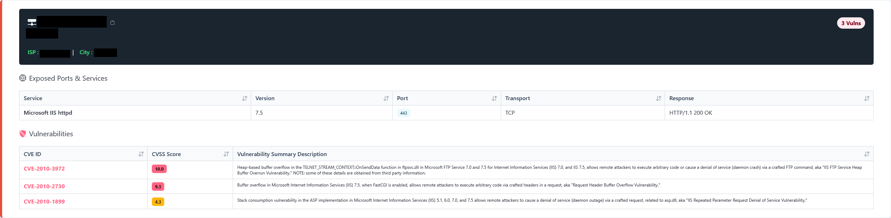
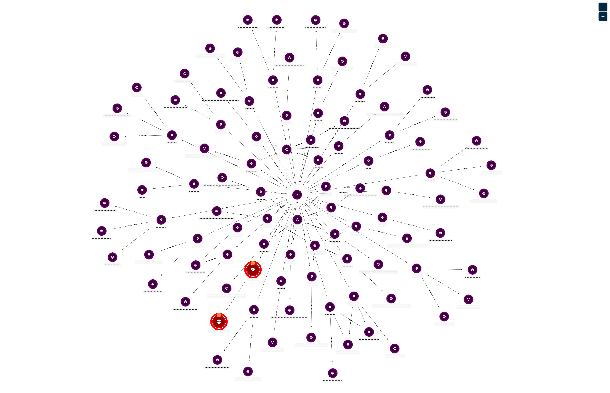
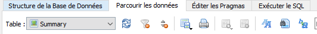

# Shodan2DB
This tool generates a report on the attack surface exposed on the internet based on Shodan exports.

Shodan exports include vulnerability data and tags (`vuln` and `tag`) that aren’t directly accessible online or through subscriptions such as Small Business, Corporate, or Enterprise.
This tool unlocks that data, enabling deeper vulnerability analysis and helping teams develop effective remediation plans.

You can display results on [Osintracker](https://app.osintracker.com).

`vuln` and `tag` are available with Membership plan.

You can sometimes find a Shodan lifetime membership on sale for as little as $4 or $5 during special events, such as the platform’s anniversary or Black Friday. The regular price is $49 as a one-time payment, with no annual renewal fee.

Reports use a Jinja2 template that you can replace with your own (see [Templates Customization](#templates-customization)).

## Features

- **Attack surface inventory** covering exposed hosts, services, ports, and technologies.
- **Vulnerable host inventory** with vulnerability counts and affected services.
- **CVE information** including CVSS scores, verification status, and vulnerability summaries.
- **Consolidated CVE statistics** to highlight recurring and widespread vulnerabilities.
- **Exposure analysis** to support risk-based remediation prioritization.
- **Shodan export support** for JSON and compressed JSON.GZ files.
- **Local SQLite storage** for services, network metadata, tags, and vulnerabilities.
- **Vulnerability deduplication** per IP address, service port and CVE.
- **HTML report generation** with sortable tables and client-side search.
- **Two built-in report templates**: `classic` (Bulma) and `modern` (self-contained, severity-focused), or your own Jinja2 template.
- **Osintracker export** as a JSON graph of IPs, host/domain names and their relations.
- **Interactive mode** to pick exports, database and reports from menus.

## Installation

Requires Python 3.9 or later and an export obtained through Shodan’s supported export features.

Install the `shodan2db` command with [uv](https://docs.astral.sh/uv/):

```bash
uv tool install git+https://github.com/atao/Shodan2DB
```

Or run it from a clone without installing anything:

```bash
uv run shodan2db --help
```

Without uv: `python -m pip install .` from a clone.

## Interactive mode

Run `shodan2db` without arguments (or `shodan2db interactive`) in a terminal and answer the menus:

1. Import exports, generate reports, or both.
2. Select the Shodan exports found in the current folder (newest first, pre-selected) or type another path.
3. Pick an existing database (with its number of hosts and CVEs) or create a new one.
4. Choose the reports (HTML and/or osintracker), the template and the output files.
5. Review the summary, confirm, and optionally open the HTML report.

Use the arrow keys to move, space to select, enter to confirm and Ctrl-C to cancel at any time.

## Commands

```bash
Usage: shodan2db [OPTIONS] [COMMAND] [ARGS]...

  Parse Shodan JSON exports into SQLite and generate HTML / osintracker
  reports.

  Run without a command in a terminal to start the interactive mode.

Options:
  -V, --version  Show the version and exit.
  -h, --help     Show this message and exit.

Commands:
  export       Export the database as an HTML report, an osintracker JSON...
  interactive  Choose exports, database and reports from menus.
  parse        Parse a Shodan export and store it into a SQLite database.
```

### Command : parse

```bash
Usage: shodan2db parse [OPTIONS]

  Parse a Shodan export and store it into a SQLite database.

Options:
  -i, --input-file FILE  JSON or JSON.GZ export file from Shodan.  [required]
  -d, --database FILE    Target database name or path (.db is added if
                         missing).  [required]
  -v, --verbose          Verbose mode.
  -h, --help             Show this message and exit.
```

Importing the same export twice is safe: banners already stored (same IP, port, transport and scan time) and CVEs already linked to a port are skipped.

### Command : export

```bash
Usage: shodan2db export [OPTIONS]

  Export the database as an HTML report, an osintracker JSON file, or both.

Options:
  -d, --database FILE             Path to the SQLite database file.
                                  [required]
  -f, --format [html|osint|all]   Which export(s) to generate.  [default: all]
  -o, --output FILE               Output path for the HTML report.  [default:
                                  shodan.html]
  -t, --template, --template-file TEXT
                                  Built-in template (classic, modern) or path
                                  to a Jinja2 template.  [default: classic]
  --osint TEXT                    Central entity name for the osintracker
                                  export.  [default: shodan]
  --osint-output FILE             Output path for the osintracker JSON file.
                                  [default: assets_osintracker.json]
  -v, --verbose                   Verbose mode.
  -h, --help                      Show this message and exit.
```

## Quickstart

1. Query Shodan via the web interface and click on **"Download Results"**.


2. Select the number of results to download.


3. Download your results.


4. Run `shodan2db` in the download folder and follow the [interactive mode](#interactive-mode), or use the commands:

```bash
# Step 1: Parse and seed your structured SQLite layer
shodan2db parse -i ./example_shodan.json -d ./example_database.db -v

# Step 2: Extract analytics and output your HTML dashboard
shodan2db export -d ./example_database.db -f html -o ./example_report.html -v

# Optional - HTML dashboard + JSON for Osintracker import (default format: all)
shodan2db export -d ./example_database.db -o ./example_report.html --osint example --osint-output example_osintracker -v
```


5. See report file :

- Dataset summary

  

- Host details

  

- [Osintracker](https://app.osintracker.com) export

  

**Tags** and **vulns** are visible directly in the **Summary** table.



## Database Architecture

The schema is versioned (`PRAGMA user_version`); databases created by older releases are upgraded automatically the first time they are opened.

- **`services`**: one row per Shodan banner (IP, port, transport, scan time): service, banner, location, ISP and tags.
- **`vulnerabilities`**: one row per CVE and service port, with its CVSS score, verification status and summary.
- **`Summary` (View)**: services sorted by vulnerability count (`nbvulns DESC`).

## Templates Customization

Two templates are built in, selected with `-t`:

| Template | Description |
|---|---|
| `classic` (default) | Bulma layout: severity KPIs, one detailed section per vulnerable host (each CVE with its ports), a compact table for the other hosts, a CVE index, search and dark mode. Loads Bulma CSS and Bootstrap Icons from a CDN, so it needs internet access to be styled. |
| `modern` | Self-contained (no external resources, works offline). Severity overview, collapsible host cards sorted by risk, each CVE listed once with its ports, search and severity filters, dark mode, print-friendly. |

```bash
shodan2db export -d audit.db -f html -t modern -o audit.html
```

To customize a report, copy a built-in template from [src/shodan2db/templates/](src/shodan2db/templates/) and pass your copy with `-t` (editing the installed file would be overwritten by updates):

```bash
shodan2db export -d audit.db -f html -t ./my_report.html -o audit.html
```

Templates receive:

- `hosts`: every host sorted by risk; `vulns_hosts` / `all_hosts`: hosts with / without CVEs. Each host has `ip`, `hostnames`, `isp`, `org`, `city`, `country`, `tags`, `ports`, `products`, `services`, `cves` (one entry per CVE with its `ports`, `cvss`, `severity`, `summary`, `verified`), `vulns` (one row per CVE and port), `nbvulns`, `max_cvss` and `severity`.
- `cves`: CVEs across all hosts with `count` (hosts affected), `cvss`, `severity`, `summary`.
- `severity_counts`, `total_hosts`, `total_services`, `total_vulns`, `generated_at`, `version`.

Severities follow CVSS v3 ratings: `critical` (≥ 9.0), `high` (≥ 7.0), `medium` (≥ 4.0), `low`, `unknown` (no score) and `none` (host without CVE).

## Development

```bash
uv run pytest                                      # tests
uv run ruff check . && uv run ruff format --check . # lint
```

The package can also be used as a library:

```python
from shodan2db import export_html, export_osintracker, parse_file

parse_file("raw_shodan.json.gz", "production_audit.db", verbose=True)
export_html("production_audit.db", "exposure.html")
export_osintracker("production_audit.db", "exposure_osintracker.json", alias="Audit")
```

Errors (missing file, invalid database or template) are raised as `shodan2db.Shodan2DBError`.
